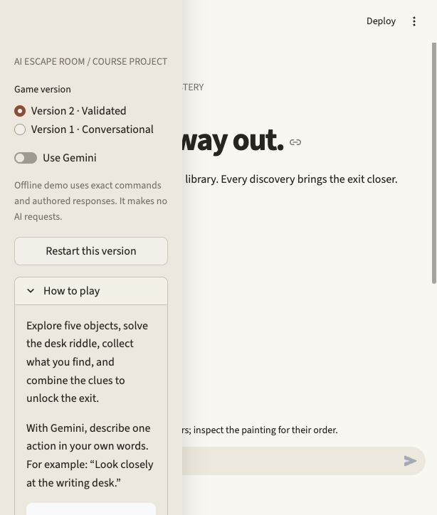
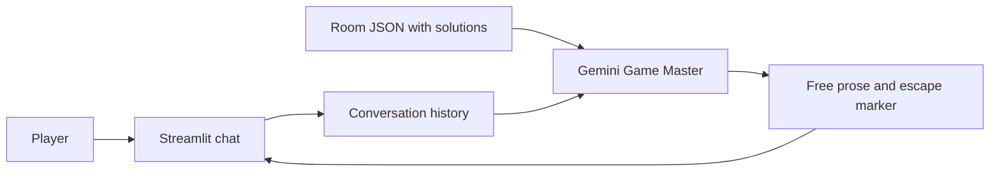
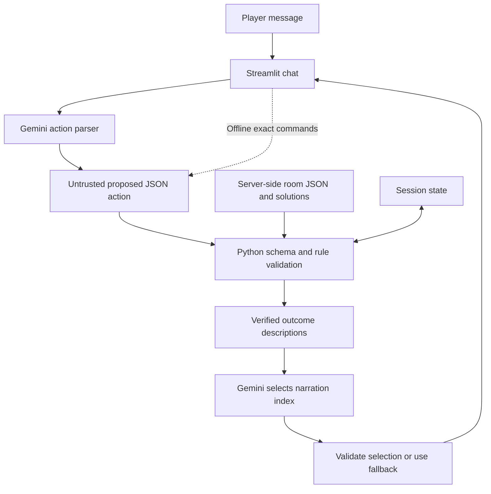

# The Last Library · AI Escape Room

A Python escape-room game built in two versions for the AI Escape Room mini-project. Investigate a locked library, solve its desk riddle, collect a brass key and combine the remaining clues to escape.



## Run locally

Requires Python 3.9 or newer (tested locally on Python 3.9).

```sh
git clone https://github.com/siddhantm29-netizen/Escape_room.git
cd Escape_room
python3 -m venv .venv
source .venv/bin/activate
# Windows: .venv\Scripts\activate
python -m pip install -r requirements.txt
python -m streamlit run app.py
```

The default **Version 2 offline demo** works without a key. Use the exact commands in the sidebar. For natural-language AI play, enable **Use Gemini**, enter your own API key and select a model available to your account. Click **Test Gemini connection**, then choose Version 1 or Version 2. The connection check makes one short API request. Never commit an API key.

The default model is `gemini-3.5-flash-lite`. Google lists standard text generation for this model on its [free tier](https://ai.google.dev/gemini-api/docs/pricing). Availability and quotas depend on your account; use a free-tier project without paid billing for this assignment. The application never switches to a different model or purchases capacity automatically. An enabled billing account can still incur provider charges: the app cannot enforce Google's billing settings.

Optionally set `GEMINI_API_KEY` and `GEMINI_MODEL` in your environment instead. `.env.example` documents the names; `.env` files are not automatically loaded. Do not put personal or sensitive information into the chat: live play sends it to Google. Keys stay in session memory and are transmitted only as an API header to Google's fixed HTTPS endpoint.

## Compare the versions

| | Version 1 | Version 2 |
|---|---|---|
| Player interface | Natural-language chat | Natural-language chat; exact commands in offline demo |
| Game authority | LLM Game Master | Python validation functions |
| Memory | Conversation history | Structured state plus conversation |
| Solutions | In the Game Master's system prompt | Server-side JSON; absent from the action parser prompt |
| Inventory and locks | Model instructions | Explicit preconditions |
| Escape recognition | Model's `[[ESCAPED]]` marker | All prerequisites and correct code checked in Python |
| Narration | Open-ended generated prose | LLM selects one of two approved descriptions |
| Bad model response | Can affect the story/completion | Rejected or replaced by a verified description |

Version 2 uses constrained narration deliberately. The LLM chooses the wording of a validated outcome instead of writing unrestricted prose. This prevents invented objects and unsolicited spoilers, at the cost of narrative variety. The parser still handles natural-language actions in live mode. No model response is executed as code or applied as a state patch.

## Architecture

### Version 1



### Version 2



[Version 1 diagram](docs/architecture-v1.svg), [Version 2 diagram](docs/architecture-v2.svg), and a [three-page report](docs/report.pdf) are included. See [design scope](docs/SPEC.md), [comparison tests](docs/TEST_CASES.md), and the [walkthrough](docs/WALKTHROUGH.md) (spoilers).

## Verification

```sh
python -m unittest discover -s tests -v
```

25 tests cover the full solution, invalid actions, inventory, repeated actions, parser/narrator failures, API transport, restart and version isolation. Streamlit AppTest runs without a browser or API key. The app was also opened in a browser and an object examination was verified visually.

**Evidence limit:** API transport tests use mocked HTTP responses. V1 limitation tests use controlled model-output fixtures. They demonstrate that V1 accepts bad model behavior while V2 rejects invalid transitions; they are not evidence that Gemini produced those outputs. The user confirmed a successful live connection check with their own key after the model update. Full live gameplay and adversarial trials are pending. Run the manual protocol in `docs/TEST_CASES.md` before presenting live AI results.

## Project structure

```text
app.py                   Streamlit UI; separate sessions for both versions
escape_room/room.json     Room objects, clues and puzzle solutions
escape_room/engine.py     V2 structured state and Python validation
escape_room/game.py       V1/V2 orchestration and offline command parser
escape_room/llm.py        Gemini REST client and safe service errors
tests/                   Unit, boundary and Streamlit integration tests
docs/                    Report, diagrams, test comparison and demo guide
```

Sessions are in-memory and restartable; a fresh browser session resets progress. Each version keeps its own game. Play is bounded to 60 turns per version and 1,000 characters per message. Live V1 uses one model request per turn; V2 uses up to two. A parser outage applies no action; a narrator outage preserves the validated action and shows an authored fallback. The source code is a portfolio artifact, so someone reading the repository can see the solutions. V2 protects the game interaction, not secrets from a reader of the code.

## Portfolio and submission

This project demonstrates LLM integration, Python state machines, validation, adversarial tests and a Streamlit interface. Include the report and repository link in your submission. For a class demo, show a normal V1 action, repeat a bypass attempt in both versions, complete V2, and inspect its state. Use the comparison table to explain the change in trust boundary.

The local clone is prepared for publication; it has not been pushed. Local Git history contains separate engine, application and validation milestones. To publish your prepared local commits to your repository, run:

```sh
git push -u origin main
```

No hosted deployment or remote push is performed by the app. No database, paid API, training or fine-tuning is needed.

## References

- Assignment brief: requirements supplied separately in the course PDF.
- [Gemini generateContent reference](https://ai.google.dev/api/generate-content)
- [Gemini pricing and free-tier eligibility](https://ai.google.dev/gemini-api/docs/pricing)
- [Streamlit chat input](https://docs.streamlit.io/develop/api-reference/chat/st.chat_input)
- [Streamlit AppTest](https://docs.streamlit.io/develop/api-reference/app-testing/st.testing.v1.apptest)
