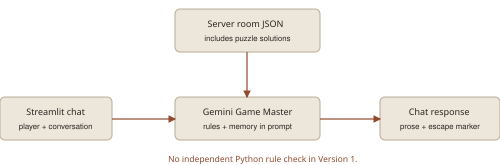
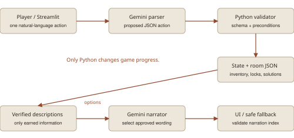

# The Last Library
AI Escape Room | Completed application report | 8 November 2026

## Room, puzzles and replay
The Last Library is a Python/Streamlit escape room with five interactive objects: desk, bookshelf, painting, locked drawer and exit door. Examining the desk reveals a riddle. Solving it reveals a brass key, which must be collected before the drawer opens. Four clue fragments are distributed across the desk, bookshelf, painting and drawer. Their symbols and relative-position statements determine the digit order. The drawer note explains the ordering task; hints offer reasoning nudges without assembling the answer.

Each new browser session or restart samples four distinct digits and rebuilds the clue text and matching door code from a private copy of the room configuration. Ordinary Streamlit reruns preserve that puzzle. The two versions have independent conversations and session puzzles. The checked-in room.json remains a reproducible template, not a universal live-game solution. Random generation can occasionally repeat a previous combination.

## Interface and usability
The redesigned page uses a playful investigation workspace: conversation and object controls beside an evidence board on desktop, stacked on narrow screens. Version 2 shows earned clues in discovery order, their source objects, inventory, clue count and exit status. Reading a locked drawer cannot reveal its note. Context buttons collect an available key and read an accessible note through the same rules as chat. Version 1 keeps clues in its conversation. Instructions, restart and API controls remain available.

## Version 1: conversational baseline
Gemini receives the session room configuration, including solutions, and conversation history. It narrates actions and tracks progress through text. Python accepts the model's escape marker rather than independently validating progress. This preserves the assignment's normal-play baseline, but forgotten prerequisites, invented items, leaked answers or an early completion marker can produce incorrect play.

Both versions default to gemini-3.5-flash-lite through the Gemini REST API. Version 1 uses temperature 0.2; Version 2 uses 0.0. Requests allow 1,024 output tokens and a 25-second timeout. The model ID is configurable and a connection-test control checks access. Lower temperature alone does not enforce game rules.

# Reliable actions and private sessions
Version 2 | Python owns progress; the model interprets and selects wording

## Validation outside the model
Version 2 keeps inventory, discoveries, solved puzzles, lock status and the session puzzle in Python. The model proposes a JSON action with exactly kind, target and value. The engine rejects malformed fields, unavailable objects and unmet prerequisites. Proposed answers and codes must appear explicitly in the player's current message. Common object names, inspection synonyms, note commands, direct riddle answers and four-digit attempts also have deterministic shortcuts.

A key must be revealed and collected before use. The drawer must be opened before its clue can be recorded. A correct code alone is insufficient: the desk riddle, bookshelf, painting and drawer trail must also be completed. Repeated discoveries do not duplicate items or clues. The hidden session configuration is excluded from the public state display.

## Containing hallucinations and failures
After validation, Python provides two equivalent descriptions of the earned outcome. Gemini selects an index; it cannot supply new player-facing prose on this path. An invalid selection uses the authored response. A parser failure applies no action; a narrator failure preserves the validated result. Explicit HTTP errors distinguish invalid keys, access problems, quota limits and service failures. Offline Version 2 supports authored commands without API access.

## Keys and diagnostic logs
Each visitor supplies their own Gemini key, held only in session memory. The app does not save it in cookies, browser storage, files, logs or a shared key setting. Refresh starts a fresh session; Clear API key stops further use without deleting current progress. Disconnected sessions may remain briefly in server memory. The footer explains Google transmission, quotas, billing, temporary progress and diagnostic uploads.

Diagnostics retain only UTC timestamp, event, version, mode, outcome, elapsed milliseconds, processing stage and HTTP status. They exclude keys, chat, action types, selected objects, clues, inventory and puzzle progress. Optional automatic uploads use an administrator's private repository-scoped token and a separate public app-logs branch under logs/. Failed uploads remain queued for retry. Older cached entries are sanitized before display or upload.

# Evidence, fixes and deployment
Verification against the completed application

## Automated and browser checks
All 86 automated tests pass. They cover complete offline play, wrong and premature codes, inventory gates, malformed model responses, invented answers, API failures, session/version isolation, key clearing, clue display, log privacy, upload retry and action ordering. Random-puzzle tests verify matching digit text and code, solvability across generated sessions, an unchanged template, stable puzzles during play and regeneration on restart. GitHub's Game checks workflow passed for application commit 6f4c759.

Browser play verified inspection, solving the riddle, key collection, drawer opening, reading the note, the full notebook, victory and restart. Layout checks at 320, 375, 768, 1280 and 1920 pixels found no horizontal overflow in the main content. Keyboard activation and a visible focus outline were checked. Tested custom text colour pairs had at least 5.85:1 contrast. The page uses native Streamlit controls and responsive CSS, without Bootstrap; these checks do not guarantee every device or certify accessibility.

## Comparison and bugs resolved
Six controlled comparison cases cover an uncollected key, incorrect drawer code, claimed puzzle completion, administrator impersonation, secret-solution requests and an invented escape window. The V1 harness accepts injected prose or escape markers; V2 rejects invalid transitions. These are fault-injection tests, not measured Gemini attack-success rates. V2 limits both state corruption and free-form spoiler output while retaining natural-language interpretation.

Resolved defects include accepting a drawer code as key use, matching answers inside longer words or numbers, unsafe malformed API responses, hidden HTTP errors and whitespace-only keys. Command handling now recognizes bare objects, book after the desk riddle, open/read note and Check Drawer. Earned clues remain visible in the notebook. Browser testing also exposed a dropped quick action when chat arrived immediately afterward; a session queue now processes actions in order.

## Portfolio and hosting
The completed app, report, architecture diagrams and tests are in github.com/siddhantm29-netizen/Escape_room. The workflow checks dependency compatibility, Python syntax, tests and known dependency vulnerabilities. Python 3.12 is the tested hosting setup; requirements pin Streamlit 1.67.0 and Pillow 13.0.0. Streamlit Community Cloud must connect to main and run app.py. GitHub Pages cannot execute this Python app. No deployed Cloud URL or real token-based log upload was verified in this work.

## Limits and references
The user previously confirmed a successful live Gemini connection check. Full live gameplay and repeated adversarial model trials were not re-evaluated for the final build. V1 remains model-authoritative; V2 can still misinterpret intent, although Python controls valid progress. Sessions are temporary, limited to 60 turns per version and have no durable saves. The design combines avoid-ai-design and Hallmark guidance with retained licences. Assignment basis: MiniProject_01_EscapeRoom.pdf. Implementation references: ai.google.dev/api/generate-content; docs.streamlit.io/develop/api-reference/app-testing; deployment steps and detailed evidence are in docs/DEPLOYMENT.md and docs/REDESIGN.md.
